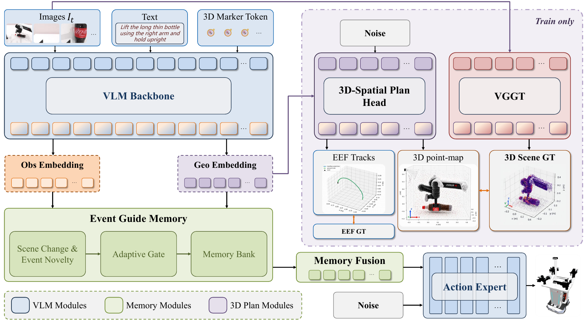
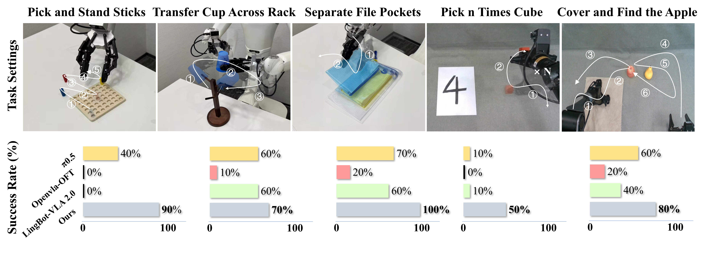
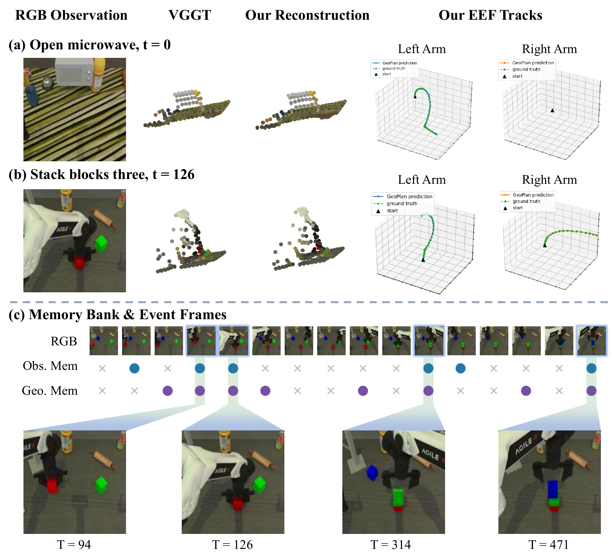
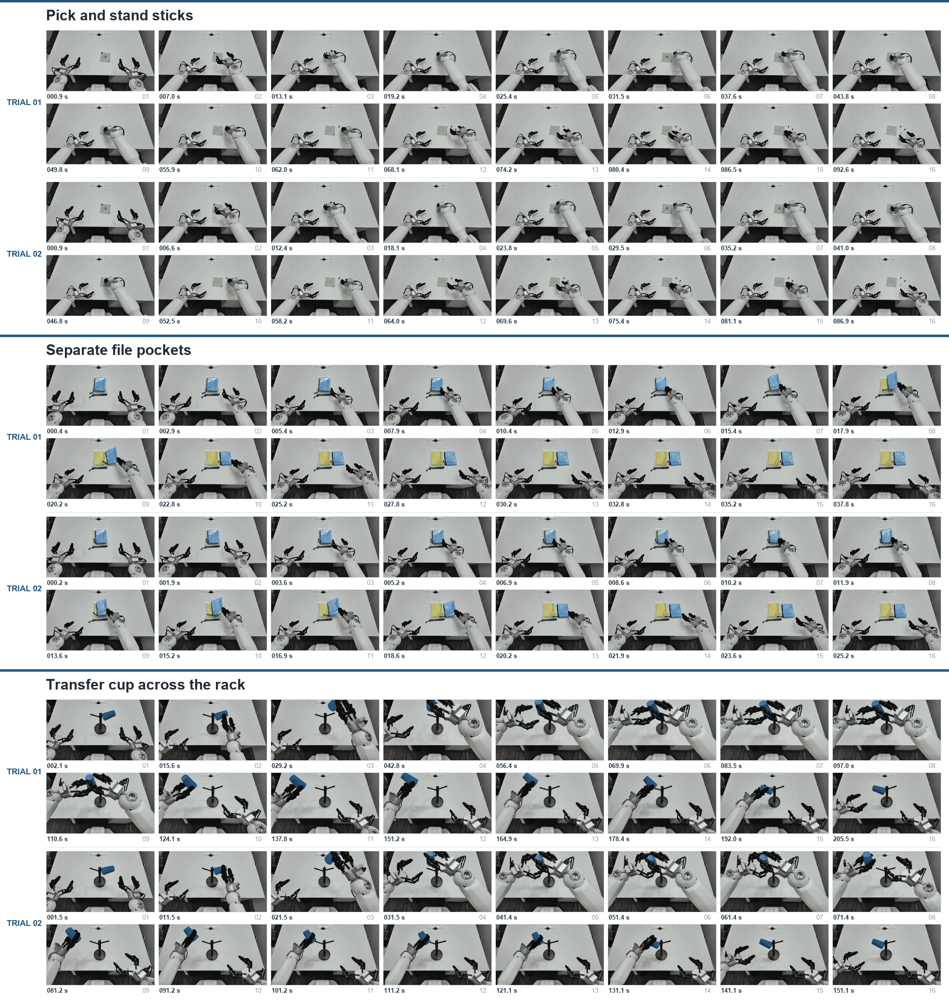
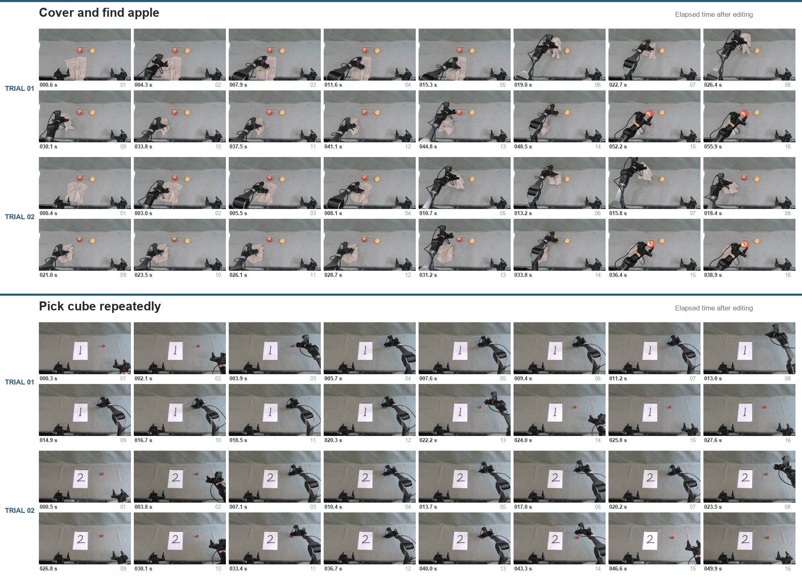
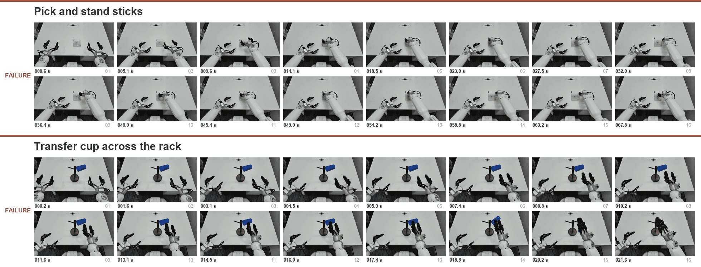
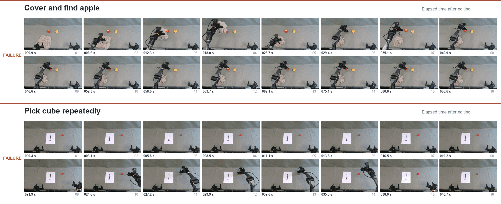

<div align="center">

# GeoMem-VLA

**Internalizing 3D Scene Understanding into Temporal Memory for Vision-Language-Action Models**

 [Paper](https://arxiv.org/pdf/2610.29866) · [Hugging Face](https://huggingface.co/rxc205/GEOMEM-VLA) · [Project page](https://geomem-vla.github.io/) · [Installation](#installation) · [Quick Start](#quick-start)

</div>

## Overview

GeoMem-VLA combines a Qwen3-VL backbone, a flow-matching action head, and causal episodic memory. During training, a frozen VGGT teacher provides geometry supervision for compact GeoPlan tokens. At inference, the policy uses accumulated memory without running the geometry teacher.

- **Geometry supervision:** compact GeoPlan tokens trained with 3D auxiliary targets.
- **Episodic memory:** causal retrieval across observations, with memory reset between episodes.
- **Benchmark workflows:** a LIBERO quick start and a separate RoboTwin integration.

[](assets/paper/architecture.pdf)

*Architecture from the manuscript. The VLM encodes observations, language, and geometry marker tokens; geometry and observation features feed episodic memory and the action expert. The VGGT teacher and geometry reconstruction head are used during training.*

This repository accompanies the GeoMem-VLA research project. The figures and results below come from the manuscript; the [quick start](#quick-start) provides a simplified training and evaluation entry point. Model weights, datasets, and simulators are provided separately.

## Results

### Simulation benchmarks

Success rates reported in the manuscript (%):

| Benchmark | Spatial | Object | Goal | Long | Average |
| --- | ---: | ---: | ---: | ---: | ---: |
| **LIBERO** | 99.6 | 99.8 | 99.6 | 96.6 | **98.9** |

| Benchmark | Clean | Randomized | Average |
| --- | ---: | ---: | ---: |
| **RoboTwin 2.0** | 91.10 | 91.24 | **91.17** |

LIBERO uses 50 trials per task across four 10-task suites (2,000 episodes). RoboTwin uses 100 episodes per task and setting across 50 tasks (5,000 episodes per setting).

<details>
<summary><strong>Component ablations</strong></summary>

| Configuration | LIBERO average (%) | RoboTwin average (%) |
| --- | ---: | ---: |
| **GeoMem-VLA** | **98.9** | **91.17** |
| Without geometry branch | 97.9 | 89.71 |
| Without temporal memory | 98.2 | 90.18 |

Removing the geometry branch removes its supervision, geometry tokens, geometric memory, and fusion while retaining observation memory. Removing temporal memory disables historical retrieval while retaining current geometry and supervision.

</details>

### Real-world manipulation

[](assets/paper/real_world_tasks.pdf)

*Manuscript evaluation on Astribot S1 and AgileX Cobot Magic 2: 60 demonstrations per task and 10 independent closed-loop evaluation rollouts per task. GeoMem-VLA achieves 90%, 70%, 100%, 50%, and 80% on the five tasks shown, respectively.*

**Reproduction scope.** These are manuscript-reported results, not new evaluations of this release. The default 20k-step recipe, dataset subset, memory settings, and one-task evaluation are not the full paper protocol. Real-world figures document the research experiments; this release contains LIBERO and RoboTwin adapters, not the real-robot deployment packages. [Result sources and figure provenance](assets/paper/README.md).

## Case Studies

### Geometry reconstruction and temporal memory

[](assets/paper/geometry_memory_case.pdf)

*Randomized RoboTwin examples: open microwave and stack three blocks. Top: observations, VGGT point-map targets, reconstructed geometry, and future end-effector tracks (solid: prediction; dashed: demonstration). Bottom: retained timestamps in observation and geometry memory.*

This is an **offline demonstration diagnostic**, using the paper's 200k-step checkpoint and 16 causally processed observations with capacity-eight banks. The observation-memory row shows timestamps retained by both observation banks. It does not depict a rollout from the default release configuration.

### Real-world execution sequences

<details>
<summary><strong>Astribot S1 — sticks, file pockets, and cup transfer</strong></summary>



Representative successful sequences from the manuscript, with two trials per task shown.

</details>

<details>
<summary><strong>AgileX — finding a covered apple and repeated cube manipulation</strong></summary>



Representative successful sequences. The figure reports elapsed time after editing, not unedited wall-clock duration.

</details>

<details>
<summary><strong>Failure cases</strong></summary>





Representative unsuccessful executions from the manuscript appendix, complementing the successful examples above.

</details>

## Installation

Use Python 3.10+ and a CUDA GPU. Clone the repository, then activate your model environment:

```bash
git clone https://github.com/GeoMem-VLA/GeoMem-VLA.git
cd GeoMem-VLA

pip install -r requirements.txt
pip install -e .
```

The model environment requires a CUDA-compatible PyTorch installation. Install the LIBERO simulator in a separate environment using the [LIBERO setup guide](examples/LIBERO/README.md#simulator-environment).

## Quick Start

The following workflow trains on **LIBERO spatial** and evaluates **one task**.

### 1. Configure external assets

```bash
cp .env.example .env
```

Edit `.env` with your own paths:

| Variable | Required asset |
| --- | --- |
| `BASE_VLM` | Local Qwen3-VL-4B-Instruct model directory |
| `VGGT_CKPT` | VGGT weights file |
| `VGGT_REPO` | VGGT source root containing `vggt/models/vggt.py` |
| `LIBERO_DATA_ROOT` | Parent directory of the LeRobot LIBERO dataset folders |
| `LIBERO_HOME` | External LIBERO simulator repository, for evaluation |
| `CKPT` | Trained policy checkpoint, for evaluation |

Keep `Qwen3-VL` in the base model directory name so the backbone dispatcher can identify it. Local paths belong in `.env`, which is ignored by Git.

Export the settings in each terminal that runs training or evaluation:

```bash
set -a
source .env
set +a
```

### 2. Prepare the data

Download the spatial dataset and install its modality metadata:

```bash
bash examples/LIBERO/data_preparation.sh
```

Already have the data? See the [dataset layout instructions](examples/LIBERO/README.md#data). For all four LIBERO suites, set `LIBERO_SUITES="spatial object goal 10"` before running the preparation script.

### 3. Train

In the model environment:

```bash
RUN_ID=libero_geomem_basic bash examples/LIBERO/train_files/run_libero_train.sh
```

The default run uses one GPU, a per-device batch size of **16**, a group size and memory length of **16**, and **20,000 training steps**. Outputs are written under `results/Checkpoints/libero_geomem_basic/`. External experiment logging is disabled.

Use a new `RUN_ID` for a new experiment. To resume an existing run, use the same ID with `IS_RESUME=True`.

### 4. Evaluate

Update `CKPT` in `.env` to a saved policy checkpoint and reload the settings. Keep the checkpoint's configuration and dataset statistics in their original run directory.

**Terminal 1 — model environment:**

```bash
bash examples/LIBERO/eval_files/run_policy_server.sh
```

**Terminal 2 — LIBERO simulator environment:**

```bash
set -a
source .env
set +a
bash examples/LIBERO/eval_files/eval_libero.sh
```

By default, evaluation runs the first spatial task once, with state input and streaming memory enabled. This checks the evaluation workflow; it is not a benchmark score. To evaluate the full spatial suite:

```bash
MAX_TASKS=-1 NUM_TRIALS_PER_TASK=50 bash examples/LIBERO/eval_files/eval_libero.sh
```

## Configuration

Benchmark-specific settings live in the training YAML files. Common launch options can be overridden through environment variables in [.env.example](.env.example).

| Setting | LIBERO | RoboTwin |
| --- | --- | --- |
| Training configuration | [YAML](examples/LIBERO/train_files/starvla_cotrain_libero.yaml) | [YAML](examples/Robotwin/train_files/starvla_cotrain_robotwin.yaml) |
| Dataset mixture | `libero_spatial_state` | `robotwin_all_50_q99` |
| Per-device batch / group / memory length | 16 / 16 / 16 | 16 / 16 / 16 |
| Gradient accumulation | 4 | 8 |
| Effective batch on one GPU | 64 frames | 128 frames |
| Training steps | 20,000 | 20,000 |
| Evaluation guide | [LIBERO](examples/LIBERO/README.md) | [RoboTwin](examples/Robotwin/README.md) |

<details>
<summary><strong>Memory, GeoPlan, and resource settings</strong></summary>

Keep `MEM_LENGTH=GROUP_SIZE` and make the per-device batch size a multiple of the group size. A group contains temporally ordered frames from one trajectory; frames are not independent episodes.

For a smaller memory footprint, reduce batch, group, and memory length together:

```bash
PER_DEVICE_BATCH_SIZE=8 GROUP_SIZE=8 MEM_LENGTH=8 \
  bash examples/LIBERO/train_files/run_libero_train.sh
```

Gradient accumulation increases the effective batch size, but does not extend the temporal history within a group. GPU memory requirements depend on the hardware and configuration and have not been benchmarked for this release.

Shared GeoPlan defaults: **16 query tokens**, **512 hidden dimensions**, **4 head layers**, and **8 attention heads**. Perceptual features use 64 tokens. Geometry diagnostic probes are disabled by default.

Data loading uses 4 workers with a prefetch factor of 2. Warmup lasts 100 steps, and checkpoints are saved every 1,000 steps. LIBERO uses action-derived EEF auxiliary targets; RoboTwin disables EEF supervision for the official joint-space data.

</details>

## Repository Structure

```text
starVLA/
├── model/framework/       # Model composition; GeoMem-VLA uses QwenGeoGR00T
├── model/modules/         # GeoPlan, memory, VLM, and action heads
├── dataloader/            # Dataset loading, transforms, and sampling
├── training/              # Training loops and checkpoint utilities
└── config/                # Training and DeepSpeed configurations
examples/
├── common/                # Shared training launcher
├── LIBERO/                # Data preparation, training, and evaluation
└── Robotwin/               # RoboTwin adapter and examples
deployment/model_server/   # Policy loading and WebSocket inference
```

Additional StarVLA model implementations are retained alongside the GeoMem-VLA workflow. See [release notes](RELEASE_NOTES.md) for the scope of this source release.

## Acknowledgments

This project builds on StarVLA and uses Qwen3-VL, VGGT, LIBERO, and RoboTwin components. Upstream attribution is preserved. The existing [CITATION.cff](CITATION.cff) describes **upstream StarVLA**, not a separate GeoMem-VLA publication.

## License

See [LICENSE](LICENSE) for the repository's license terms. External model weights, datasets, and simulators are subject to their respective licenses.
